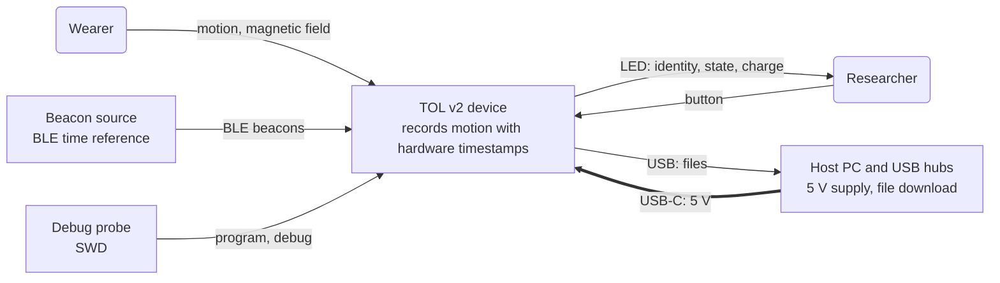
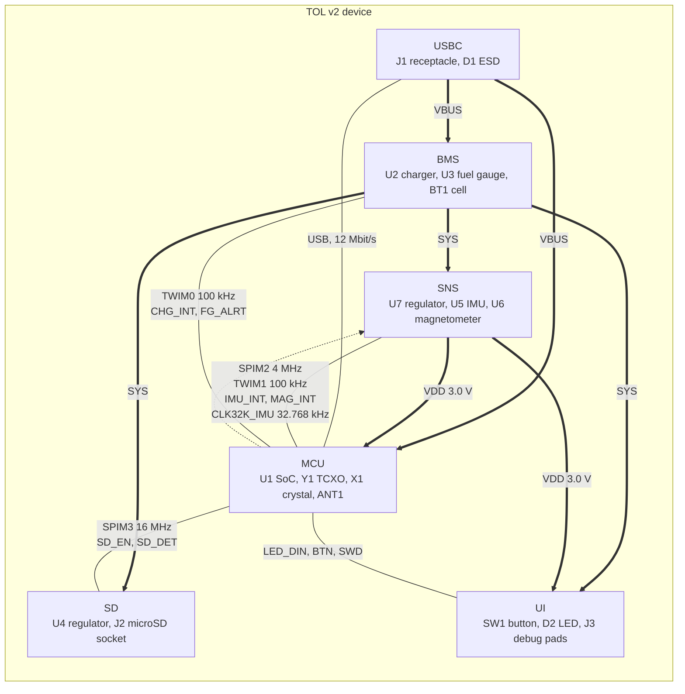
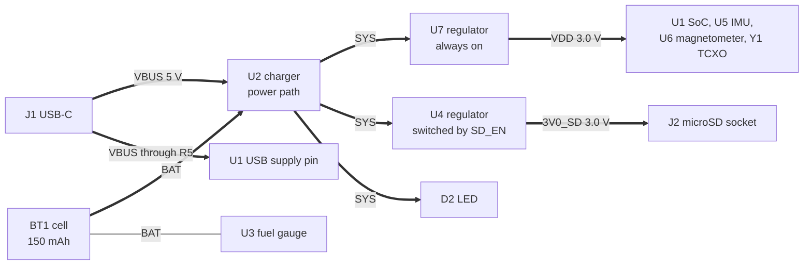
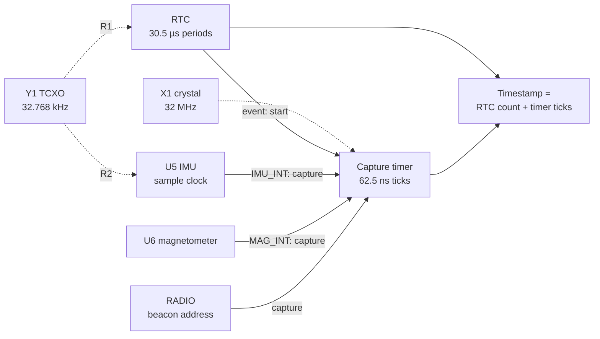

# TOLv2: Wearable IMU Logger for Synchronised Multi-Person Motion Capture 

 

## Contents

- [Introduction](#introduction)
- [Rationale](#rationale)
- [System overview](#system-overview)
  - [Level 1: system context](#level-1-system-context)
  - [Level 2: modules](#level-2-modules)
- [System breakdown](#system-breakdown)
  - [USBC: connector and protection](#usbc-connector-and-protection)
  - [BMS: charger, fuel gauge and cell](#bms-charger-fuel-gauge-and-cell)
  - [SNS: sensors and main rail](#sns-sensors-and-main-rail)
  - [MCU: SoC, clocks and radio](#mcu-soc-clocks-and-radio)
  - [SD: card and card rail](#sd-card-and-card-rail)
  - [UI: button, LED and debug](#ui-button-led-and-debug)
  - [PCB](#pcb)
- [JLCPCB ordering](#jlcpcb-ordering)
- [Firmware rules](#firmware-rules)
  - [F1: charger](#f1-charger)
  - [F2: storage](#f2-storage)
  - [F3: sensors](#f3-sensors)
  - [F4: clock](#f4-clock)
  - [F5: card](#f5-card)
  - [F6: GPIO and buses](#f6-gpio-and-buses)
  - [F7: timing and sleep](#f7-timing-and-sleep)
  - [F8: recovery](#f8-recovery)
  - [Rails](#rails)
  - [IMU](#imu)

## Introduction

TOL v2 is an open-hardware inertial logger that a person wears. The logger records acceleration, angular rate and magnetic field. A maximum of 32 devices record on one time reference.

- **Size:** 35.4 mm × 21.4 mm × 9.9 mm with battery and enclosure.
- **IMU (inertial measurement unit):** 6-axis ICM-45686, anti-aliased output, 6.4 kHz maximum.
- **Magnetometer:** 3-axis MMC5983MA, output 1 kHz maximum.
- **Cell:** 150 mAh LiPo. Approximately 9 days of continuous record at 100 Hz (0.64 mA).
- **Standby:** approximately 6 months at 32 µA, with wake on motion.
- **Card:** removable microSD card, 8 GB minimum.
- **USB-C:** cell charge and full-speed data transfer (12 Mbit/s).
- **Radio:** Bluetooth Low Energy (BLE) with a long-range mode and a 2 Mbit/s mode.
- **Sync:** BLE beacons give the time reference. The target error between devices is 1 ms.
- **Clock:** one temperature-compensated crystal oscillator (TCXO) for the system on chip (SoC) and the IMU. Hardware timestamps for events.
- **Charge control:** programmable charger and fuel gauge.

## Rationale

TOL v2 is designed as a successor to the Tiny Open Logger (TOL v1): 

| Gap in earlier work | Source | TOL v2 response |
|---|---|---|
| A timestamp is a sample count multiplied by a nominal interval. | TOL v1 | The interrupt lines of the sensors connect to a capture timer. A TCXO is the clock source of the real-time counter. |
| The clock rates of 2 devices are different by 40 to 67 ppm. The offset is 336 ms maximum after 2 h. | TOL v1 | Each device has a TCXO with a tolerance of ±1.9 ppm at 0 to 50 °C. |
| There is no sync between devices. Sync with magnet pulses has an error of 7 to 40 ms and a range of 11 cm. | TOL v1 | BLE beacons give one time reference to all devices. The target error is 1 ms. |
| A device that streams data has sync. But this device uses 350 mA and needs Wi-Fi and a server. | HARNode (Lepold et al., 2025) | Each device records to its card. The current calculation has the receiver on for 2 ms each second. |
| The download uses flash memory at 1 MHz, CSV text and one Wi-Fi access point for each device. | TOL v1 | The card is removable. USB transfers the files at full speed. USB hubs connect a group of devices to one host PC. |
| There is no sleep mode, no fuel gauge and no measured current. The SoC uses 17 to 28 mA. | TOL v1 | Calculated current: 0.58 mA in normal record mode, 32 µA in standby. The board has a fuel gauge and a programmable charger. |
| Rules for home-made boards limit the design. Manual assembly of LGA parts is not a task for a non-expert. | TOL v1 | An assembly service makes the board. All fitted parts are in the JLCPCB parts library. |
| The button shares a boot pin of the SoC. | TOL v1 | The button connects to a GPIO pin with no boot function. |
| Sessions have 6 to 20 persons and last approximately 2 h. Download was one device at a time. Children touch the devices. Sweat goes into the devices. | Ward et al., 2018; Sun et al., 2026 | A maximum of 32 devices. Charge and download through USB hubs. One button, for use below a membrane. |

## System overview

### System context

- The researcher starts and stops a session with the button.
- The LED shows the device identity, the device state and the state of charge.
- The beacon source sends a BLE beacon at intervals of 60 s maximum. This repository does not contain a beacon source.

### Modules

External connections: host PC to USBC, beacon source to MCU, wearer to SNS, researcher and debug probe to UI.

| Module | Input | Process | Output |
|---|---|---|---|
| USBC (USB-C connector) | 5 V and USB data from the cable; electrostatic discharge | Identifies the device as a power sink. Clamps electrostatic discharges. | `VBUS`; USB data pair |
| BMS (battery management) | `VBUS`; settings on TWIM0 | Selects the power source. Charges the cell. Measures the state of charge. | `SYS`; `CHG_INT`; `FG_ALRT`; state-of-charge data on TWIM0 |
| SNS (sensors) | `SYS`; motion; magnetic field; `CLK32K_IMU`; commands on SPIM2 and TWIM1 | Regulates `SYS` to 3.0 V. Measures acceleration, angular rate and magnetic field. | `VDD`; samples on SPIM2 and TWIM1; `IMU_INT`; `MAG_INT` |
| MCU (microcontroller) | `VDD`; `VBUS`; samples; `IMU_INT`; `MAG_INT`; `BTN`; `SD_DET`; `CHG_INT`; `FG_ALRT`; state-of-charge data; beacons; USB data | Gives timestamps to events. Holds samples in a buffer. Writes files. Operates BLE and USB. | Card data on SPIM3; `SD_EN`; `LED_DIN`; `CLK32K_IMU`; commands on SPIM2 and TWIM1; settings on TWIM0; BLE packets; USB data |
| SD (card) | `SYS`; `SD_EN`; card data on SPIM3 | Switches the card rail. Stores files. | `SD_DET`; card data on SPIM3 |
| UI (user interface) | `SYS`; `VDD`; button press; `LED_DIN`; SWD signals from the debug probe | Sets `BTN` high during a press. Shows the device state. Connects the debug probe to the SoC. | `BTN`; light; SWD signals to the SoC |

**Power**

- U2 supplies `SYS` from `VBUS` when `VBUS` is present. If not, U2 supplies `SYS` from the cell.
- U7 supplies the main rail `VDD` (3.0 V) at all times.
- U4 supplies the card rail `3V0_SD` (3.0 V) only while `SD_EN` is high.

**Data**

- The IMU and the card each have an SPI master. A card write does not stop a sensor read.
- The charger and the fuel gauge share one I2C bus. The magnetometer has a second I2C bus.

**Timing**

- Y1 is the clock source of the real-time counter (RTC) of the SoC and of the IMU.
- An RTC event starts the capture timer. A sensor edge or a beacon captures the timer value.
- The capture timer operates only in a capture interval. The current calculation uses one interval of 2 ms each second.
- Each device calculates its offset and rate from the beacons.

**Modes**

| Mode | Calculated current | Wake source |
|---|---|---|
| Normal record mode | 0.58 mA | |
| Standby | 32 µA | Motion |
| Off | 15.1 µA | Button |
| Device storage | 3.5 µA | |

- Normal record mode: IMU setting 100 Hz, magnetometer 25 Hz.
- High-rate record mode: IMU setting 400 Hz, magnetometer 100 Hz.
- Records use 16-bit samples.
- In off mode the SoC is in System OFF. A button press starts the SoC.

## System breakdown
### USBC: connector and protection

Sheet: [electronics/USBC.kicad_sch](electronics/USBC.kicad_sch)

| Part | Input | Process | Output |
|---|---|---|---|
| J1 USB-C receptacle, R3, R4 | 5 V and USB data from a USB host or charger | Connects the cable to the board. R3 and R4 (5.1 kΩ) identify the device as a power sink. | `VBUS` (5 V); `USB_D+`; `USB_D-` |
| D1 ESD array (AOZ8904CIL) | Electrostatic discharge on `USB_D+`, `USB_D-` or `VBUS` | Clamps the line voltage. | Clamped voltage on the line |

- USB 2.0 only. The CC lines connect only to R3 and R4. The device can use default USB power only.
- The USB data pair connects directly to the SoC. The speed is 12 Mbit/s (full speed).
- The working voltage of D1 is 5.5 V. D1 does not protect the USB supply pin of the SoC.
- The capacitance on `VBUS` is 9.4 µF nominal and 10.3 µF at +10 % tolerance. The USB-C limit for a sink is 10 µF.

### BMS: charger, fuel gauge and cell

Sheet: [electronics/BMS.kicad_sch](electronics/BMS.kicad_sch)

| Part | Input | Process | Output |
|---|---|---|---|
| U2 charger (BQ25180, I2C address 0x6A) | `VBUS`; `BAT`; temperature signal from RT1; settings on TWIM0 | Supplies `SYS` from `VBUS` or from the cell. Charges the cell at the set current and voltage. | `SYS`; charge current; `CHG_INT` |
| U3 fuel gauge (MAX17048, I2C address 0x36) | Cell voltage on `BAT` | Calculates the state of charge. | State-of-charge data on TWIM0; `FG_ALRT` |
| RT1 thermistor (10 kΩ NTC) | Board temperature near U2 | Changes its resistance with temperature. | Temperature signal to U2 |
| BT1 pads for the cell pack | Charge current from U2 | The cell pack stores the energy. | `BAT` |

- A cell pack is a 150 mAh LiPo cell with a protection circuit. The assembler does not fit the cell pack.
- Firmware writes the charge settings for this cell. See [F1](#f1-charger).
- Only the fuel gauge measures the cell voltage. See [Rails](#rails).
- The board has no protection circuit and no reverse-polarity protection.
- Pad 1 of BT1 is positive. Examine the polarity before you solder the cell pack.
- Cell limits: charge at 150 mA maximum, at 0 to 45 °C. Discharge at 300 mA maximum.

### SNS: sensors and main rail

Sheet: [electronics/SNS.kicad_sch](electronics/SNS.kicad_sch)

| Part | Input | Process | Output |
|---|---|---|---|
| U7 regulator (TPS7A0230) | `SYS` | Regulates `SYS` to 3.0 V at all times. | `VDD` for the SoC, the sensors, the TCXO and the pull-up resistors |
| U5 IMU (ICM-45686) | `VDD`; motion; `CLK32K_IMU`; commands on SPIM2 | Measures acceleration and angular rate on 3 axes each. Holds 8 kB maximum in its buffer. | Samples on SPIM2; `IMU_INT` (data ready or buffer level) |
| U6 magnetometer (MMC5983MA, I2C address 0x30) | `VDD`; magnetic field; commands on TWIM1 | Measures the field on 3 axes with 18 bits. | Samples on TWIM1; `MAG_INT` (measurement complete) |

- The enable pin of U7 connects to `SYS`. Firmware cannot set `VDD` to off. The sensors sleep by command ([F3](#f3-sensors)).
- With the clock from Y1, the IMU rate is the set rate × 1.024. A setting of 100 Hz gives 102.4 Hz.
- TDK application note AN-000478 gives this ratio for low-noise mode. The design uses the same ratio for low-power mode.
- `VDD` stays at 3.0 V until `SYS` decreases to approximately 3.3 V. Below this voltage, `VDD` decreases with `SYS`.
- Minimum supply voltage: magnetometer 2.8 V, IMU 1.71 V, SoC 1.7 V.
- U7 is stable with 0.5 to 22 µF. `VDD` has 13.1 to 20.8 µF effective (calculated).

### MCU: SoC, clocks and radio

Sheet: [electronics/MCU.kicad_sch](electronics/MCU.kicad_sch)

| Part | Input | Process | Output |
|---|---|---|---|
| U1 SoC (nRF52840) | `VDD`; `VBUS` through R5; `CLK32_MCU`; samples; `IMU_INT`; `MAG_INT`; `BTN`; beacons; USB data | Gives timestamps to events. Holds samples in a buffer. Writes files to the card. Operates BLE and USB. | Card data on SPIM3; `SD_EN`; `LED_DIN`; sensor commands; charger settings; BLE packets; USB data |
| Y1 TCXO (TG-3541CE), R24, C47 | `VDD` through the filter R24 and C47 | Makes a 32.768 kHz clock with temperature compensation. | `CLK32_MCU` through R1; `CLK32K_IMU` through R2 |
| X1 crystal (32 MHz), C1, C2 | Drive from U1 | Sets the frequency of the high-frequency clock. | Clock for the radio, USB and the capture timer |
| ANT1 chip antenna, C3, L1, C4, L5, L6 | 2.4 GHz signal from U1; radio waves | Connects U1 to the antenna through the matching network. Transmits and receives. | Radio waves; 2.4 GHz signal to U1 |

SoC pin map. High is `VDD` (3.0 V). Low is ground. TWIM, SPIM and I2S are peripherals of the nRF52840.

| Pin | Net | Direction | Function | Notes |
|---|---|---|---|---|
| `P0.00` | `CLK32_MCU` | In | XL1 | 32.768 kHz from Y1 through R1 |
| `P0.04` | `BTN` | In | GPIO, wake | High = press. Internal pull-down |
| `P0.05` | `MAG_INT` | In | Timer capture | High = measurement complete |
| `P0.06` | `IMU_MISO` | In | SPIM2 MISO | |
| `P0.07` | `IMU_INT` | In | Timer capture | Data ready or buffer level |
| `P0.08` | `IMU_CS` | Out | GPIO | Low = IMU selected |
| `P0.11` | `BMS_SCL` | Out | TWIM0 SCL | R6, 10 kΩ to `VDD` |
| `P0.12` | `BMS_SDA` | In/out | TWIM0 SDA | R7, 10 kΩ to `VDD` |
| `P0.13` | `LED_DIN` | Out | I2S data out | R22 pull-down. Idle low |
| `P0.14` | `SD_EN` | Out | GPIO | High = card rail on. R20 pull-down |
| `P0.15` | `CHG_INT` | In | GPIO | Low pulse = charger event. Internal pull-up |
| `P0.16` | `SD_DET` | In | GPIO | Low = no card. Internal pull-up only during a read |
| `P0.17` | `SD_CS` | Out | SPIM3 CSN | Low = card selected |
| `P0.18` | `NRESET` | In | Reset | From J3. Only after UICR PSELRESET = 18 |
| `P0.19` | `SD_SCK` | Out | SPIM3 SCK | R21 pull-down |
| `P0.20` | `MAG_SCL` | Out | TWIM1 SCL | R9, 10 kΩ to `VDD` |
| `P0.21` | `SD_MOSI` | Out | SPIM3 MOSI | To the card CMD pin |
| `P0.22` | `MAG_SDA` | In/out | TWIM1 SDA | R19, 10 kΩ to `VDD` |
| `P0.23` | `SD_MISO` | In | SPIM3 MISO | From the card DAT0 pin |
| `P0.25` | `FG_ALRT` | In | GPIO | Low = alert. Internal pull-up |
| `P0.26` | `IMU_SCK` | Out | SPIM2 SCK | |
| `P0.27` | `IMU_MOSI` | Out | SPIM2 MOSI | |
| `P1.00` | `SWO` | Out | Trace | To J3. Optional |

- GPIO pins that are not in the table have no connection. The I2S block uses `P0.24` and `P1.08` as clock outputs ([F6](#f6-gpio-and-buses)).
- The SoC operates in normal voltage mode. Its 2 supply inputs connect to `VDD`. See [Rails](#rails).
- Y1 tolerance: ±1.9 ppm at 0 to 50 °C. Y1 gives a valid clock 3 s maximum after power-on.
- Y1 needs its supply at 0 V for more than 10 s before a new power-on.
- With no beacon for 10 min, the time difference between 2 devices increases to 2.3 ms maximum (calculated).
- The 2.3 ms figure includes only the ±1.9 ppm tolerance of Y1. With solder shift, ageing and supply tolerance, the figure is 10.7 ms.
- The target timestamp error is 5 µs.
- C44 and C45 are not fitted. They are positions for antenna tuning parts. The matching network is not tuned for this board.
- TP4 is a bare test pad on the output of Y1.
- C9 (820 pF) is necessary for this SoC variant, NRF52840-QIAA-R.
- The debug port is not locked on this SoC variant.

### SD: card and card rail

Sheet: [electronics/SD.kicad_sch](electronics/SD.kicad_sch)

| Part | Input | Process | Output |
|---|---|---|---|
| U4 regulator (TPS7A0230) | `SYS`; `SD_EN` | Supplies 3.0 V while `SD_EN` is high. Discharges the card rail when off. | `3V0_SD` |
| J2 microSD socket (TF-110) and card | `3V0_SD`; card data on SPIM3 | Operates in SPI mode. Stores the files. | Card data on SPIM3; `SD_DET` (low = no card) |
| R12 to R16, R20, R21 | SoC pins that float during a reset | R12 to R16 pull the card lines up to `3V0_SD`. R20 holds `SD_EN` low. R21 holds `SD_SCK` low. | Defined levels on the card lines |

- The assembler does not fit a card.
- Data rate: 1.9 kB/s (21 MB in 3 h) in normal record mode, 7.8 kB/s (84 MB in 3 h) in high-rate record mode.
- The card rail is on only during a buffer write: approximately each 67 s in normal record mode.
- R12 to R16 connect to `3V0_SD`. As a result, the resistors cannot supply a card that has no power.

### UI: button, LED and debug

Sheet: [electronics/UI.kicad_sch](electronics/UI.kicad_sch)

| Part | Input | Process | Output |
|---|---|---|---|
| SW1 button | A press; `VDD` | Connects `VDD` to `BTN` during a press. | `BTN` (high = press) |
| D2 RGB LED (WS2812B) | `SYS`; `LED_DIN` at 800 kbit/s | Decodes the colour data. | Light: device identity, device state, state of charge |
| J3 debug pads (Tag-Connect TC2030) | SWD signals from the debug probe | Connects the debug probe to the SoC. | `SWDIO`; `SWCLK`; `NRESET`; `SWO` |

- J3 has 6 bare pads: `VDD`, `SWDIO`, `NRESET`, `SWCLK`, GND, `SWO`.
- TP1, TP2, TP3 and TP5 are bare test pads: `BAT`, `SYS`, `VDD`, GND.
- `SYS` supplies the LED. The LED data level comes from `VDD`. This level limits `SYS` to 4.4 V. See [F1](#f1-charger).
- The sensor interrupt lines have no test pads.

### PCB

Board: [electronics/TOLv2.kicad_pcb](electronics/TOLv2.kicad_pcb). Custom rules: [electronics/TOLv2.kicad_dru](electronics/TOLv2.kicad_dru).

- Size: 26.5 mm × 17.78 mm. Copper layers: 6. Finish: ENIG.
- Stack-up: JLC06081H-2116. Thickness: 0.83 mm ± 0.10 mm.
- Footprints: 81. 70 are on the top side and 11 are on the bottom side. The assembler fits 72.
- Not fitted: BT1, J3, TP1 to TP5, C44, C45.
- Vias: 178 through vias, all filled and capped. 99 are in a pad. 124 have a 0.15 mm hole.
- Minimum track and gap: 0.10 mm.
- Target impedance (calculated): 50 Ω for the antenna feed, 90 Ω for the USB data pair.
- KiCad 10.0.8 checks: DRC gives 0 violations. ERC gives 0 errors and 3 label warnings.

| Layer | Use |
|---|---|
| Top | Most parts, antenna feed, crystal, TCXO |
| Inner 1 | Ground plane |
| Inner 2 | Signals |
| Inner 3 | `VDD` pour; `VBUS`, `BAT` and `SYS` tracks |
| Inner 4 | Ground plane |
| Bottom | microSD socket, charger, USB data pair, card lines, debug pads |

## JLCPCB ordering

The production files are in [electronics/production/](electronics/production/).

| File | Content |
|---|---|
| `electronics/production/TOLv2.zip` | Gerber and drill files |
| `electronics/production/bom.csv` | Bill of materials (BOM): 37 lines, each with an LCSC part number |
| `electronics/production/positions.csv` | Placement file (CPL): 72 parts on 2 sides |

1. Go to [jlcpcb.com](https://jlcpcb.com). Click **Instant Quote**.
2. Upload `electronics/production/TOLv2.zip`. The page reads the board size and the number of layers.
3. Set the PCB options:

   | Option | Value | Reason |
   |---|---|---|
   | Base Material | FR-4 | |
   | Layers | 6 | |
   | Dimensions | 26.5 mm × 17.78 mm | The page reads this value from the file. |
   | PCB Qty | The quantity that you need | |
   | Different Design | 1 | |
   | Delivery Format | Single PCB | The file contains one board. |
   | PCB Thickness | 0.8 | Nominal value in mm. The stack-up gives 0.83 mm. |
   | Surface Finish | ENIG | The smallest pads are 0.25 mm. |
   | Outer Copper Weight | 1 oz | |
   | Inner Copper Weight\* | 0.5 oz | |
   | Layer Stackup\* | JLC06081H-2116 | The track widths are for this stack-up. |
   | Impedance Control\* | No | JLCPCB then gives no impedance test. The track widths and the stack-up set the impedance. |
   | Specify Layer Sequence\* | `.gtl`, `.g1`, `.g2`, `.g3`, `.g4`, `.gbl` | Top to bottom. |
   | Via Covering\* | Epoxy Filled & Capped | 99 vias are in a pad. |
   | Min via hole size/diameter | The option for a 0.15 mm hole | 124 vias have a 0.15 mm hole. |
   | PCB Remark | `Fill and cap all vias.` | JLCPCB asks for a note on filled vias. |

4. Set **PCB Assembly** to on. Set the assembly options:

   | Option | Value | Reason |
   |---|---|---|
   | PCBA Type\* | Standard | Parts are on 2 sides. |
   | Assembly Side\* | Both Sides | 65 parts are on the top side and 7 are on the bottom side. |
   | PCBA Qty\* | The quantity that you need | This quantity cannot be more than PCB Qty. |
   | Edge Rails/Fiducials\* | Added by JLCPCB | The file has no edge rails. |
   | X-Ray Inspection\* | On | The report plans X-ray inspection for U1, U2, U5 and U6. |

5. If the page shows a message about a minimum size of 70 mm, select **JLCPCB helps to add edge rails**\*.
6. Click **Confirm**. Examine the top view and the bottom view. Click **Next**.
7. Upload `bom.csv` as the BOM. Upload `positions.csv` as the CPL. Click **Process BOM&CPL**.
8. Make sure that each of the 37 lines has a matched part. Click **Next**.
9. If a line shows **No Parts Selected**, click **Search**. Select the part with the LCSC number of that line.
10. Examine the position and the rotation of each part in the placement view. Click **Next**.
11. On the **Quote & Order** page, select the product description. Save the order to the cart.
12. Click **Secure Checkout**. Pay for the order.
13. Answer the messages from the JLCPCB engineers. An order with the status "Pending" waits for your answer.

The order does not include these items:

- A cell pack for BT1: EEMB LP401730, 150 mAh, with a protection circuit.
- A microSD card of 8 GB minimum.
- An SWD debug probe and a Tag-Connect TC2030-IDC-NL cable for J3.

## Firmware rules

The hardware makes these rules necessary. The schematic sheets refer to the rules by ID.

Source column: a number or a letter is a section of the [design report](docs/TOL_v2__Hardware_Design_of_a_Wearable_IMU_Logger.pdf). A name is a note on that schematic sheet. Section D.1 is the summary table of the report.

A SoC start is a power-on or a reset of the SoC.

### F1: charger

| ID | Rule | Reason | Source |
|---|---|---|---|
| F1.1 | At each SoC start, first disable the charge function. | The charger starts with its defaults: 10 mA, 4.20 V, hot limit approximately 60 °C. The cell limit is 45 °C. | 4.6 |
| F1.2 | Then write these settings. Charge voltage: 4.19 V. Charge current: 130 mA (code 40). Input current limit: 300 mA. `SYS`: 4.4 V. Hot limit: 45 °C. | 130 mA plus tolerance is less than the cell limit of 150 mA. 300 mA fits the `VBUS` track (calculated). | D.1, 4.6, 5.4 |
| F1.3 | Read each setting from the charger. Keep the card and the LED off until all values are correct. | The reset input current limit is 500 mA. The `VBUS` track is for the 300 mA setting. | 4.6, 5.4 |
| F1.4 | Enable the charge function only in the approved temperature range. Until this range is defined, limit the charge current and the charge conditions. | RT1 measures the board temperature, not the cell temperature. | 4.6 |
| F1.5 | Disable the long-press action of the charger. | The default action is ship mode. The button connects to the SoC, not to the charger. | D.1, BMS |
| F1.6 | Disable the charger watchdog. | If the watchdog is on, it sets all registers to their defaults 160 s after the last I2C transaction. | D.1, BMS |
| F1.7 | Set the VDPPM_DIS bit. | The headroom is low. | D.1 |
| F1.8 | Do F1.1 to F1.7 again after each charger reset and each USB connection. | The charger can go back to its defaults. | D.1, BMS |
| F1.9 | Do not set `SYS` above 4.4 V. Do not use pass-through mode. | At a higher `SYS`, the LED data level from `VDD` is too low. | 4.5, UI |
| F1.10 | Do not use ship mode, hardware reset or SYS_MODE 11. | These modes discharge `SYS`. Current then flows back through U7 and U4. | BMS, SNS, SD |

Limit: cell temperature sense and charge termination are not resolved (D.1).

### F2: storage

| ID | Rule | Reason | Source |
|---|---|---|---|
| F2.1 | For device storage, set SYS_MODE to 10. | In this mode `SYS` floats. | D.1, BMS |
| F2.2 | Do not use shutdown mode or a different mode that discharges `SYS`. | See F1.10. | D.1, BMS |
| F2.3 | Put the fuel gauge to sleep. | The sleep current is 0.5 µA typical. | D.1, BMS |
| F2.4 | Keep the charger watchdog off. | See F1.6. | D.1 |

Limit: an accidental collapse of `SYS` is not resolved (D.1).

### F3: sensors

| ID | Rule | Reason | Source |
|---|---|---|---|
| F3.1 | Reset the IMU by command at each SoC start. | The rise time of `VDD` is unknown. The IMU needs a rise time of 0.01 to 1 ms. | D.1, 4.4, SNS |
| F3.2 | Set `IMU_CS` high before the first IMU access. | The chip select is a software signal. Low selects the IMU. | MCU |
| F3.3 | Disable the pull-up on IMU pin 9 before you select the external clock. | Pin 9 is the clock input from Y1. | D.1, SNS |
| F3.4 | Reset the magnetometer at each SoC start. Wait 10 ms after power-on and after the reset. | The magnetometer needs 10 ms to start. | D.1, SNS |
| F3.5 | Put the sensors to sleep by command. | Firmware cannot set `VDD` to off. | SNS |

Limit: the IMU datasheet does not say that a command reset corrects a bad supply ramp (D.1).

### F4: clock

| ID | Rule | Reason | Source |
|---|---|---|---|
| F4.1 | At SoC start, use the internal low-frequency RC oscillator. | Y1 needs 3 s maximum to give a valid clock. | D.1, MCU |
| F4.2 | After 3 s, stop the low-frequency clock. Select the external full-swing clock (bypass) on `P0.00`. Start the clock again. | The clock source must not change while the clock operates. | D.1, MCU |
| F4.3 | After the change, set a new time reference for the timestamps. | The change of clock source changes the time reference. | D.1 |
| F4.4 | Before a capture, start the 32 MHz crystal oscillator. Wait until the oscillator is stable. Then set the reference between the RTC and the capture timer. | The internal high-frequency oscillator drifts 30 to 160 µs in 2 ms. The target timestamp error is 5 µs. | C.1 |
| F4.5 | Correct the clock rate of each device with the beacons. | The ±1.9 ppm tolerance applies only at 0 to 50 °C. | 4.2, MCU |
| F4.6 | Operate the 32 MHz crystal oscillator for the radio and for USB. | The radio and USB need the crystal clock. | MCU |

### F5: card

| ID | Rule | Reason | Source |
|---|---|---|---|
| F5.1 | To apply power, set `SD_EN` high. Wait 1 ms. Then send 74 clock cycles at 400 kHz. | The card model of the report uses this start sequence. | C, SD |
| F5.2 | Complete all writes before you remove power from the card. | Recovery of a file after an interrupted write is not available. | D.1 |
| F5.3 | To remove power, hold `SD_SCK`, `SD_MOSI`, `SD_CS` and `SD_EN` low for 10 ms minimum. | The card rail must be below 0.5 V for 1 ms minimum. | D.1 |
| F5.4 | After each SoC reset, remove power from the card. Then apply power again. | The report gives no reason. During a reset the SoC pins float. | D.1, 4.7 |
| F5.5 | Enable the pull-up on `SD_DET` only while you read the pin. | With no card, the switch connects the pin to ground. | D.1, SD |

### F6: GPIO and buses

| ID | Rule | Reason | Source |
|---|---|---|---|
| F6.1 | Enable the internal pull-ups on `P0.15` (`CHG_INT`) and `P0.25` (`FG_ALRT`). | These open-drain lines have no pull-up resistors on the board. | D.1, BMS |
| F6.2 | On `P0.04` (`BTN`), enable the internal pull-down and the wake on high level. | SW1 has no resistor. A press wakes the SoC from System OFF. | D.1, UI |
| F6.3 | Limit the card SPI clock to 16 MHz. Use default-speed mode only. | The maximum clock in default-speed mode is 25 MHz. The nearest lower SoC setting is 16 MHz. High-speed mode can use 200 mA, the limit of U4. | D.1, 4.5, SD |
| F6.4 | Limit the IMU SPI clock to 4 MHz. | At 8 MHz the data setup time is 3.5 ns. The IMU needs 13 ns. | D.1, 4.5 |
| F6.5 | Limit the 2 I2C buses to 100 kHz. | With 10 kΩ pull-ups, the fuel gauge pins have too much capacitance for 400 kHz. The magnetometer datasheet gives no pin capacitance. | D.1, 4.5 |
| F6.6 | Use high drive on the card SPI outputs. | The report specifies high drive for the 16 MHz bus. | A |
| F6.7 | Keep `LED_DIN` low during the SoC start. | Low is the idle level of the LED data line. | D.1, UI |
| F6.8 | Set the LED to off when the fuel gauge voltage is less than 3.32 V. | The supply voltage range of the LED is 3.3 to 5.3 V. | D.1, D |
| F6.9 | Keep the internal pull-down on `P0.05` (`MAG_INT`) until the magnetometer interrupt is on. | The line is high-impedance until then. | MCU |
| F6.10 | Use the I2S block for `LED_DIN`. Assign the I2S clock outputs to `P0.24` and `P1.08`. | These 2 pins have no connection. | MCU |
| F6.11 | Use SPIM2 for the IMU and SPIM3 for the card. | TWIM1 has the same peripheral ID as SPIM1. | MCU |

### F7: timing and sleep

| ID | Rule | Reason | Source |
|---|---|---|---|
| F7.1 | Operate the capture timers and the GPIO event channels only in capture intervals. | A timer that operates continuously increases the calculated current from 0.58 mA to 1.02 mA or more. | D.1, C.1 |
| F7.2 | In standby, use PORT wake detection. | PORT detection adds only 0.01 µA. | D.1, C |
| F7.3 | Before System OFF, put the sensors to sleep. Remove power from the card. Then clear the active alerts. | `FG_ALRT` stays low until firmware clears the alert. | D.1, BMS |
| F7.4 | Record each missed capture. | After a missed capture, timestamps are not correct until firmware sets a new reference. | D.1, C.1 |
| F7.5 | Do not force the hibernate mode of the fuel gauge. | Forced hibernate is only for loads below C/4. | BMS |

Note: a capture of each magnetometer edge increases the calculated current to 0.60 to 0.61 mA. The 0.58 mA figure does not include the start of the crystal oscillator.

### F8: recovery

| ID | Rule | Reason | Source |
|---|---|---|---|
| F8.1 | Start the SoC watchdog early in each SoC start. | The device is sealed. A person cannot remove the power. | D.1, BMS |
| F8.2 | Feed the watchdog only after the main loop makes progress. | A stalled loop must cause a reset. | D.1 |
| F8.3 | Set the watchdog timeout to more than the time of the longest permitted blocking operation. | The TCXO start takes 3 s maximum. Card operations can also block. | D.1 |

Limit: firmware that feeds the watchdog incorrectly can stay stalled (D.1).

### Rails

| ID | Rule | Reason | Source |
|---|---|---|---|
| Rails.1 | Set DCDCEN to 1. | Regulator REG1 has its filter, L2 and L3. | MCU |
| Rails.2 | Keep DCDCEN0 at 0. | Regulator REG0 has no filter. REG0 is off in normal voltage mode. | MCU |
| Rails.3 | Do not write REGOUT0. | REG0 is off (Rails.2). `VDD` supplies the SoC. | MCU |
| Rails.4 | Read the cell voltage from the fuel gauge only. | The cell voltage connects to no SoC pin. | MCU, 4.6 |

### IMU

| ID | Rule | Reason | Source |
|---|---|---|---|
| IMU.1 | Set INT1 of the IMU to push-pull before you use `IMU_INT`. | After a reset INT1 is open-drain and active low. The line has no pull-up. | SNS, MCU |
| IMU.2 | Select the external clock on IMU pin 9. | Y1 supplies 32.768 kHz through R2. The IMU and the SoC then use the same clock. See F3.3. | SNS, 3 |
| IMU.3 | Calculate the sample rate as the set rate × 1.024. | AN-000478 gives this ratio for low-noise mode. The design uses the same ratio for low-power mode. | SNS, 3 |
| IMU.4 | In each capture interval, capture an `IMU_INT` edge with the capture timer. Calculate the times of the other samples from the clock. | The current calculation has one capture interval of 2 ms each second. One sample has 320 clock periods at the 100 Hz setting. | MCU, 3, C.1 |
